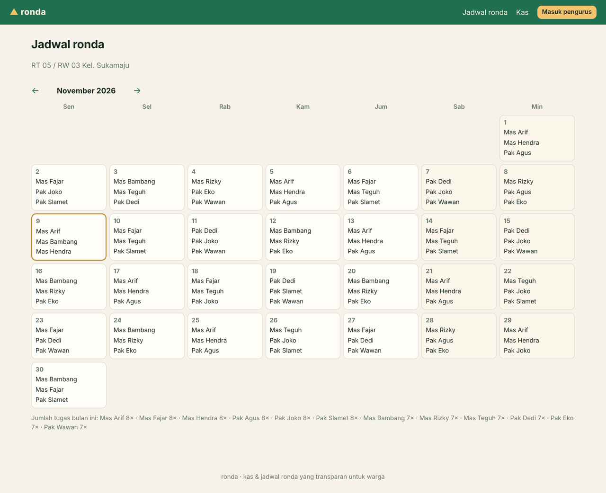
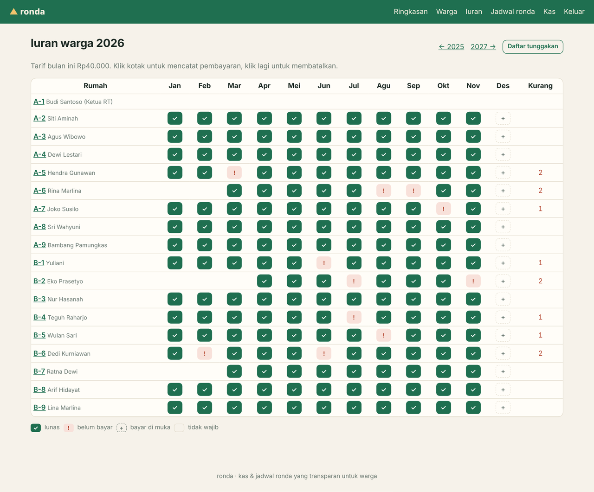
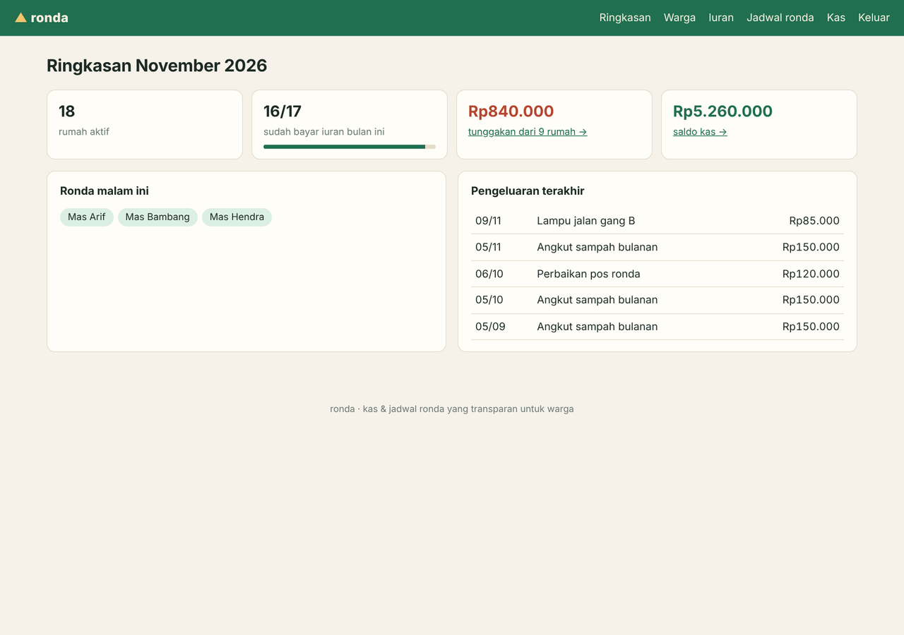
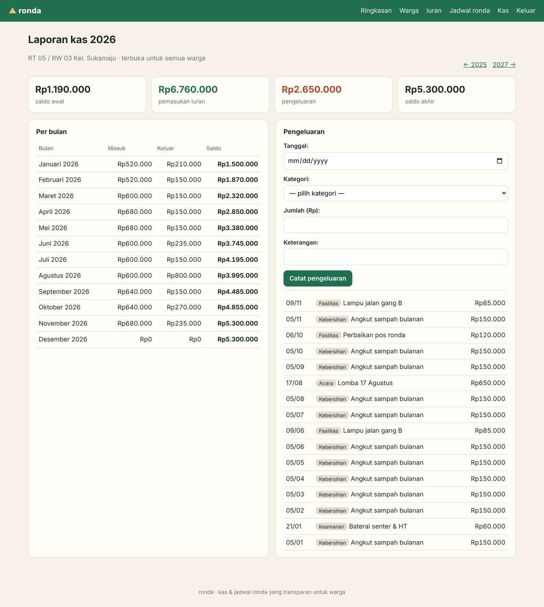

# ronda

**Neighbourhood (RT) administration for Indonesian communities — dues, cash book and a fair night-watch roster.**

Every *RT* (rukun tetangga, the smallest neighbourhood unit in Indonesia) runs on the same
three chores: collecting the monthly *iuran*, keeping the *kas* (cash book) honest, and
organising the *ronda malam* (night watch). Most RTs do it on paper or in a WhatsApp group,
and the arguments are always the same — *who hasn't paid?*, *where did the money go?*,
*why am I on duty again?*

`ronda` turns those into one small Django app:

| Jadwal ronda (public) | Iuran matrix |
|---|---|
|  |  |

| Ringkasan | Laporan kas (public) |
|---|---|
|  |  |

## Features

- **Iuran matrix** — households × months; click a cell to record a payment (HTMX, no page reload),
  click again to undo. Rates can change over time (e.g. Rp30.000 → Rp40.000 from July) and each month is
  billed at the rate in force *for that month*. Move-in / move-out dates and exempt households are respected,
  paying ahead is allowed.
- **Tunggakan** — arrears per household with a one-click **WhatsApp reminder** (`wa.me` link with a prefilled
  polite message, `08…` numbers normalised to `628…`).
- **Fair ronda roster** — generate a month in one click:
  1. never on a weekday the resident marked unavailable,
  2. never two nights in a row (also across month boundaries),
  3. fewest shifts first → longest rest first → seeded shuffle, so it is balanced *and* reproducible
     (same seed = same schedule). Nights that can't be filled are reported.
- **Tukar jadwal** — tick two shifts and swap them; the swap is validated against the same rules.
- **Transparent cash book** — monthly income/expense/running balance and every expense, visible to all
  residents **without logging in**, just like the roster.
- Indonesian UI, `Asia/Jakarta` time zone, integer Rupiah everywhere.

## Stack

Django 6 · HTMX 2 (vendored, no build step) · SQLite · plain CSS · pytest-django · ruff

```
rt/
├── models.py            Household, DuesRate, DuesPayment, Expense, Guard, Shift
├── services/
│   ├── dues.py          expected months, arrears, payment rules, cash book, reminder text
│   ├── roster.py        pure roster planner + DB wrappers (generate, swap)
│   └── months.py        month arithmetic and Rupiah formatting
├── views.py / urls.py   pages + HTMX partial endpoints
├── templates/rt/        server-rendered templates, partials/ for HTMX swaps
└── management/commands/seed_demo.py
tests/                   37 tests: dues rules, roster properties, views & HTMX endpoints
```

Business rules live in `services/` and don't depend on HTTP; the roster planner is a pure
function, so its properties (balance, rest days, availability, determinism) are tested directly.

## Run it

```bash
python -m venv .venv && source .venv/bin/activate
pip install -r requirements-dev.txt
python manage.py migrate
python manage.py seed_demo          # demo RT with 18 houses; login: pengurus / ronda-demo
python manage.py runserver
```

Open http://127.0.0.1:8000/jadwal/ (public) or log in at `/masuk/`.
The Django admin is at `/admin/` for anything the UI doesn't cover (e.g. dues rates).

Configuration via environment: `DJANGO_SECRET_KEY`, `DJANGO_DEBUG=0`, `DJANGO_ALLOWED_HOSTS`, `RT_NAME`.

```bash
pytest            # 37 tests
ruff check .
```

See [ROADMAP.md](ROADMAP.md) for what's planned.

## License

MIT
